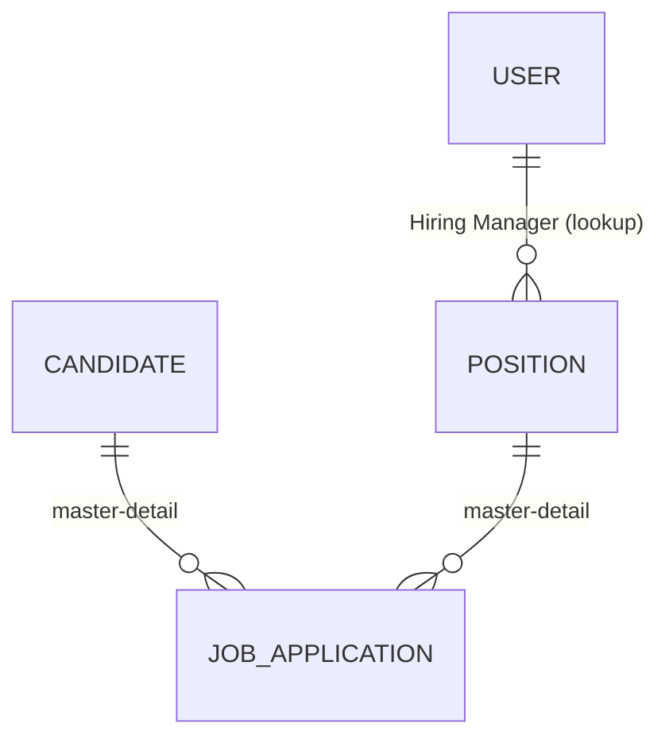
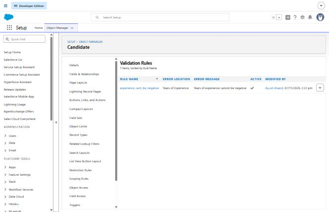
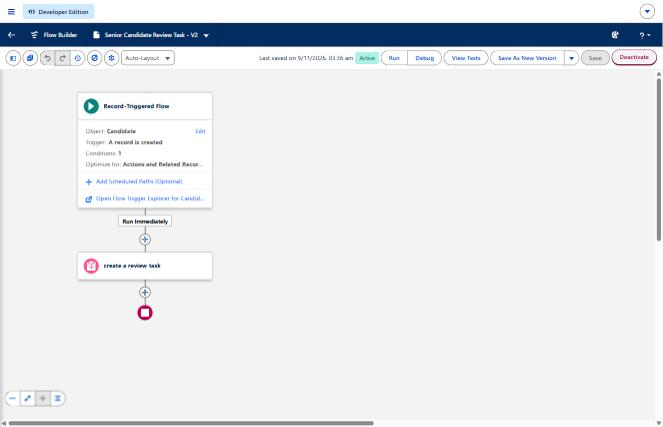
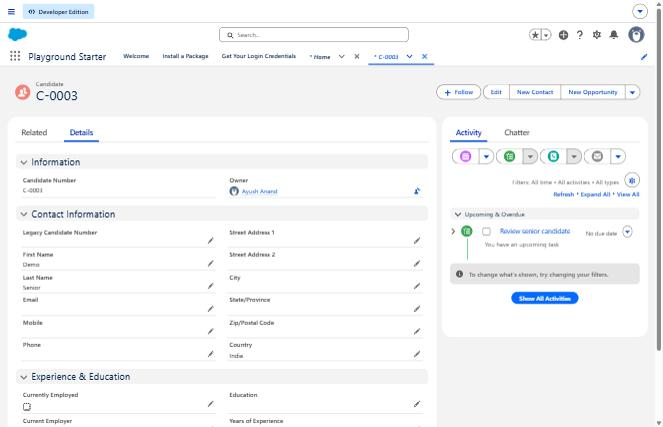

# Salesforce Recruiting App

A small recruiting application built on the Salesforce platform (Developer Edition org). It tracks open **Positions**, **Candidates**, and the **Job Applications** that connect them, and adds data-quality rules, automation, reporting and least-privilege security on top.

## Scope: what is mine and what is not

The three base objects (Position, Candidate, Job Application) and their fields were created following the Trailhead *Build a Recruiting App* starter. The work below was built and tested by me on top of that:

| Area | What I did |
|---|---|
| Data model | Changed Job Application's two lookups (Candidate, Position) to **master-detail**, making it a junction object |
| Validation | Rule on Candidate that blocks negative years of experience |
| Automation | Record-triggered Flow that creates a review Task for senior candidates |
| Reporting | Summary report "Candidates by Country" |
| Security | Permission set "Hiring Manager Delete" (least privilege) |
| Settings | Enabled Reports and Activities on Candidate |

## Data model



- **Position**: Title (name), Department, Location, Status, Pay Grade, Salary Range, Skills Required, Education, Job Description, Approval Status, Hiring Manager (lookup to User), Legacy Position Number (External ID).
- **Candidate**: Candidate Number (auto-number `C-{0000}`), First/Last Name, Email, Phone, Mobile, address fields, Current Employer, Currently Employed, Education (multi-select), Years of Experience, Legacy Candidate Number (External ID).
- **Job Application**: auto-number name, Candidate, Position, Stage, Status, Legacy Job Application Number (External ID).

### Why master-detail on Job Application
An application has no meaning without both a candidate and a position. With master-detail:
- Deleting a Candidate or Position deletes its applications (no orphans).
- The relationship is required, so every application is always attached.
- Roll-up summary fields become possible on the parents.

Trade-off: with master-detail the child inherits sharing from the parent, and reparenting is only allowed if "Allow reparenting" is enabled.

## Validation rule

Object: Candidate. Name: `experience_cant_be_negative`

```
Years_of_Experience__c < 0
```

Error message: *Years of experience cannot be negative* (shown on the Years of Experience field).


A validation rule formula returns TRUE when the data is **bad**, which is what blocks the save.

## Flow: Senior Candidate Review Task

- Type: record-triggered flow on Candidate
- Trigger: record is created
- Entry condition: `Years of Experience >= 5`
- Action: Create Records, a Task with Subject "Review senior candidate", Status Not Started, owner = `{!$Record.OwnerId}`

The Task is also linked to the Candidate (Related To = `{!$Record.Id}`), so it shows in the Candidate's activity timeline.

Tested by creating a candidate with 6 years of experience: the Task was created, assigned to the candidate's owner, and appeared on the Candidate record.




## Report

"Candidates by Country": report type Candidates, Summary format, rows grouped by Country, with subtotals and grand total.

Equivalent SOQL for a quick check:

```sql
SELECT Country__c, COUNT(Id) FROM Candidate__c GROUP BY Country__c
```

## Security

Permission set `Hiring Manager Delete` grants Candidate Read, Edit and Delete (Create is off). It is assigned to the few users who need to delete candidates, instead of editing a profile that dozens of users share. Changing the profile would give every user on that profile delete access, which breaks least privilege.

Note: Delete requires Read and Edit in the same permission set.

## SOQL examples used while learning

```sql
SELECT Name, Amount FROM Opportunity WHERE StageName = 'Closed Won'
SELECT Name, Account.Name FROM Opportunity WHERE StageName = 'Closed Won'
```

## Screenshots

Screenshots are in the `screenshots/` folder.

## Possible next steps
- Dashboard built from the Candidates by Country report
- Approval process on Position
